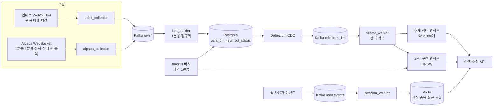

# 미국 주식·코인 실시간 데이터 기반 실시간 벡터 DB 파이프라인 (초안, 2026-11-24)

> `docs/purpose/`의 T-xx에 없는 확장 작업이다. 착수와 범위는 팀장이 결정한다.
> 노션 "추가 구현 후보 3가지"(후보 3: 업비트 + 미국 주식)를 기준으로 정리했다.
> 커머스 리플레이 설계(`commerce-reco.md`)는 이 문서로 대체한다.
> 데이터 소스 실측은 worklog "실시간 데이터 소스 탐색"(2026-11-23)에 있다.

## 1. 한 줄 정의

업비트 원화 마켓 코인 약 300개와 미국 주식 약 2,000개(Alpaca IEX, 거래가 충분한 종목만. 4절)의 실시간 시세를 하나의 벡터 공간에 넣고, 그 위에서 기능 3개를 돌린다.

| 기능 | 사용자 질문 | 쓰는 인덱스 |
|---|---|---|
| 1. 지금 비슷한 종목 | "지금 BTC와 비슷하게 움직이는 종목은?" | 현재 상태 인덱스 |
| 2. 희귀도와 과거 사례 | "지금 이 움직임, 흔한 거야?" | 과거 구간 인덱스 |
| 3. 관심 종목 추천 | "내 관심 종목과 비슷한데 아직 안 본 종목은?" | 현재 상태 인덱스 + Redis |

세 기능 모두 **상태 벡터 하나**(4절)를 같이 쓴다.

## 2. 기능

### 기능 1. 지금 비슷하게 움직이는 종목
- **결과:** 비슷한 종목 top-10. 종목마다 유사도, 최근 60분 차트(기준 종목과 겹쳐 그림), 마지막 갱신 시각을 붙인다. 코인과 주식이 섞여 나온다.
- **사용자에게:** 내 종목과 같이 움직이는 종목을 바로 본다. 코인과 미국 주식이 같이 움직이는지 따로 움직이는지(디커플링)도 보인다.
- **시스템에서:** 시장 상태가 분 단위로 바뀌어서, 인덱스가 늦으면 결과가 곧바로 틀린다. 약 2,300개 벡터가 매분 거의 전부 바뀐다 (실험 2: 갱신이 잦으면 꺼두기는 맞지 않음).

### 기능 2. 희귀도와 과거 사례
- **결과 (화면 순서대로)**
  1. 희귀도: "최근 6개월 동안 이만큼 비슷한 움직임은 3번", "상위 0.5%로 드묾"
  2. 과거 사례 10개: 종목, 시각, 유사도, 지금 차트와 겹친 차트
  3. (접어 둠) 사례들의 그 뒤 60분 흐름. 참고용이고 예측이 아니다.
- **희귀도 계산**
  - 사례 수: 과거 구간 인덱스에서 이웃 200개를 찾아, 그중 거리가 기준값 이하인 수를 센다.
    - 같은 종목의 60분 이내 창들은 한 번의 일로 묶어 1번으로 센다. 창이 겹치면 한 번의 일이 여러 창으로 잡히기 때문이다.
  - 백분위: 10번째 이웃까지의 거리를 과거 무작위 시점들의 같은 거리와 비교한다.
  - 같은 종목의 앞뒤 60분 구간은 창이 겹쳐 당연히 비슷하므로 뺀다.
- **사용자에게:** 사람이 기억으로 떠올리던 "전에도 이런 적 있었나"를 데이터 전체에서 대신 찾는다.
- **시스템에서:** 종목 × 시점 벡터가 수백만 개라 벡터 DB가 꼭 필요한 규모다. 매분 새 구간이 추가되고, 1분봉 정정(늦게 온 체결)이 오면 과거 벡터를 교체해야 한다 (실험 1·2).

### 기능 3. 관심 종목 기반 추천
- **결과**
  - (a) 관심 종목들과 지금 비슷하게 움직이는 종목 top-k
  - (b) 지금 드물게 움직이는(희귀도 높은) 종목 중 내 관심 종목과 가까운 것
  - 추천마다 이유를 붙인다 (예: "NVDA: AMD와 최근 60분 움직임이 비슷함").
- **사용자에게:** 관심 종목을 추가하면 추천이 바로 바뀐다.
- **시스템에서:** 기능 1·2는 시장 쪽 스트림만 다룬다. 기능 3은 **사용자 이벤트 스트림**을 더해 "실시간 이벤트 스트림 + 벡터 DB 추천"의 두 축을 채운다.
- **한계:** Retailrocket 같은 공개 사용자 행동 로그가 없다. 가상 사용자 시뮬레이터를 만들지, 직접 써 볼지 정해야 한다 (6절).

## 3. 파이프라인

| 단계 | 하는 일 |
|---|---|
| ① 수집 | 소스마다 수집기 1개. 받은 즉시 수신 시각을 붙여 Kafka `raw.*`에 넣는다. 끊기면 재연결하고, 끊긴 구간을 기록한다. |
| ② 1분봉 정규화 | **업비트:** 체결을 이벤트 시각 기준 1분봉으로 묶는다. 늦게 온 체결은 정정으로 처리한다. **Alpaca:** 받은 1분봉을 그대로 쓰고, 1분봉 정정을 반영한다. 두 소스를 같은 형식(`bars_1m`, `revision` 포함)으로 만든다. |
| ③ 원본 DB | Postgres가 정답 기준이다. 1분봉과 거래 정지·재개 상태를 저장한다. |
| ④ CDC | Debezium으로 `bars_1m` 변경분을 Kafka로 보낸다. |
| ⑤ 벡터 계산 | 상태 벡터를 만든다(4절). 세 기능 모두 이 벡터 하나를 쓴다. |
| ⑥ 인덱스 | **현재 상태:** 종목당 1개, 매분 교체. Flat이나 매분 재구축으로 간다. **과거 구간:** HNSW에 계속 추가한다. 정정이 오면 해당 벡터를 교체한다. |
| ⑦ 사용자 이벤트 | 앱이 관심 종목 추가·삭제, 조회 이벤트를 Kafka에 보낸다. 세션 처리기가 Redis에 반영하고, 이미 처리한 이벤트는 건너뛴다. |
| ⑧ API | 기능 1·2·3. 응답마다 "몇 시 몇 분 시세 기준"인지 붙인다. ⑩ 대시보드가 이 API를 부른다. |
| ⑨ 과거 데이터 채우기 | 서비스 시작 전에 Alpaca `feed=iex`(실시간과 같은 피드)와 업비트 분봉 REST로 과거 1분봉을 채우고, 과거 구간 인덱스를 한 번에 만든다. |
| ⑩ 관측 및 대시보드 | ⑧ API를 부르는 웹 화면 하나. 결과와, 그 결과가 얼마나 최신인지를 같이 보여 준다. **결과 화면:** 기능 1·2·3의 결과마다 "N초 전 시세 기준"을 붙인다. 정정으로 바뀐 사례, 거래 정지로 빠진 종목은 표시한다. **옆 패널** · 지금 들어오는 데이터: 업비트·Alpaca 연결 상태, 마지막으로 받은 시각, 방금 확정된 1분봉이 검색에 잡히기까지 걸린 시간 · 방금 바뀐 것: 1분봉 정정, 거래 정지·재개가 들어오는 대로 뜬다 · 검색 결과 확인: 같은 질의를 전수조사(Flat)로도 돌려, 결과와 희귀도 사례 수가 같은지 나란히 보여 준다 · 내 관심 종목: 추가한 뒤 추천이 바뀌기까지 걸린 시간 |

## 4. 정한 값

**상태 벡터 (30차원, 5분 묶음. 팀원 제안 반영 2026-11-25)**

창은 분 t에서 끝나는 최근 60분이다. 이를 5분 묶음 12개로 나눈다. 묶음 경계는 창 끝(t)에서 거꾸로 센다.
- `bars_1m`에는 1분봉을 그대로 두고, 묶음은 벡터를 계산할 때 만든다.
- 현재 상태 벡터는 매분 다시 계산하므로 신선도는 1분 단위로 유지된다.
- 과거 구간도 같은 정의로 10분 간격 창을 만든다.

| 블록 | 차원 | 값 | 가중치 |
|---|---|---|---|
| 가격 | 12 | 묶음 k의 종가가 창 시작 대비 얼마나 움직였나: ln(C_k / C_0) ÷ σ₆₀. ±5에서 자르고 5로 나눈다 | 1.0 |
| 거래량 | 12 | 묶음 k의 거래량이 평소의 몇 배인가: ln(1 + V_k ÷ V_ref). ln 11(10배)에서 자르고 ln 11로 나눈다 | 0.5 |
| 요약 | 6 | 60분 수익률 ÷ σ₆₀, ln(창 변동성 ÷ 평소 변동성), 고저 폭 ÷ σ₆₀, 최고점 위치, 최저점 위치(0~1), 체결 있는 묶음 비율 | 0.5 |

- **σ₆₀ (평소 60분 변동폭)과 V_ref (평소 5분 거래량)는 그 종목의 직전 20일 값이다.**
  - **창 자기 자신의 변동성으로 나누지 않는다.** 그렇게 하면 폭락과 작은 흔들림이 같은 모양이 되어 희귀도가 망가진다.
  - 평소 값으로 나누면 "평소의 몇 배만큼 움직였나"가 남는다. 그래서 BTC와 유틸리티주를 각자의 기준으로 한 공간에서 비교할 수 있다.
  - 미국 주식의 V_ref는 같은 시간대(30분 단위) 기준으로 잡는다. 장 시작과 마감 때 거래가 몰리는 하루 패턴 때문이다.
- **거리는 L2(유클리드)로 잰다. 블록마다 길이를 1로 맞추지 않는다.**
  - 코사인이나 블록 정규화는 움직임의 크기를 지운다. 크기가 남아야 큰 움직임이 "드물다"로 잡힌다.
  - 가중치 제곱 × 차원 수로 보면 가격 약 73%, 거래량 약 18%, 요약 약 9%의 비중이다.
- 미국 주식은 창이 밤사이 공백을 걸치지 않도록 정규장 안에서만 만든다. 그래서 **주식 벡터는 한국 시간 00:30부터** 나오고, 데모도 그 이후에 한다.

**거래가 적은 종목 처리 (팀원 피드백 반영 2026-11-25)**

근거: 11-23 IEX 실측(worklog). 상장 13,226종목 중 중간 종목은 정규장 390분 중 24분에만 1분봉이 있었다. 하루 80% 이상 찬 종목은 1분봉 기준 487개, 5분 묶음 기준 2,093개였다.
1. **오늘의 종목 목록:** 장 시작 전에 정한다. 직전 20거래일 동안 5분 묶음이 평균 80% 이상 찬 종목만 넣는다. 하루 동안 고정한다. 코인도 같은 규칙을 업비트 체결에 적용한다.
2. **창마다 확인:** 12개 묶음 중 10개 이상에 체결이 있어야 벡터를 만든다.
3. **빈 묶음 채우기:** 가격은 직전 값을 쓰고(변화 0), 거래량은 0으로 둔다.
4. **조건을 못 넘으면:** 화면에 "거래 부족"으로 표시하고 현재 상태 인덱스에서 뺀다. 희귀도는 유효한 창끼리만 비교한다.

**희귀도 기준값 (기능 2)**
- 비교 범위: 코인은 코인끼리, 주식은 주식끼리가 기본이다.
- 거리 기준: "평범한 순간이라면 이만큼 가까운 과거 사례가 10개쯤 있다"는 수준이다. 과거 무작위 표본 5,000개의 10번째 이웃 거리 중앙값으로 정하고, 하루 한 번 다시 계산한다.
- 알림(확장)은 상위 1% 이하일 때 보낸다.

**과거 구간 인덱스 규모**
- 거래 규칙을 통과한 종목, 최근 6개월, 10분 간격 창
  - 미국: 11-23 기준 하루 유효 창 약 7.5만 개 × 126거래일 → 약 950만 개
  - 코인: 150~300종목 × 하루 144창 × 182일 → 약 390만~790만 개 (규칙을 적용한 종목 수는 실측 전)
- 벡터 하나당 약 0.26KB (hnswlib, M=16 기준: 30 × 4B = 120B + 0층 링크 32 × 4B = 128B + 라벨 등)
- 합계 약 1,300만~1,700만 개, 메모리 약 3.5~4.5GB (추정). VM 12GB 안에 들어간다.

## 5. 하지 않는 것
- 매매 실행, 주문, 계좌 연동
- 가격 예측과 매수·매도 신호. 기능 2의 "그 뒤 흐름"은 접어 둔 참고 통계일 뿐이다.
- 미국 주식 전 종목의 체결·호가 단위 데이터. 무료에서는 30종목까지만 받을 수 있다.

## 6. 미결
- [ ] 사용자 이벤트를 어디서 얻나: 가상 사용자 시뮬레이터, 또는 직접 사용 (기능 3)
- [ ] 거래 정지 경로: `symbol_status` 변경이 현재 상태 인덱스에서 종목을 빼는 흐름이 3절 그림에 없다
- [ ] 현재 상태 인덱스: Flat으로 갈지, 매분 재구축하는 HNSW로 갈지. 약 2,300개면 Flat으로 충분할 것으로 추정한다.
- [ ] 과거 구간이 실시간으로 늘어나는 양: 10분 간격, 거래 규칙 적용 기준으로 하루 약 12만 개(미국 7.5만 + 코인 최대 4.3만)로 추정한다. 실측 전이다.
- [ ] 과거 데이터 채우기 비용: Alpaca와 업비트 REST의 호출 수·시간 (실측 전)
- [ ] 벡터 가중치(가격 1.0, 거래량 0.5, 요약 0.5)와 자르는 값: 과거 데이터를 채운 뒤 이웃 결과를 눈으로 보고 조정한다.
- [ ] 코인의 거래 규칙 통과 종목 수: 업비트로 실측해야 한다.
